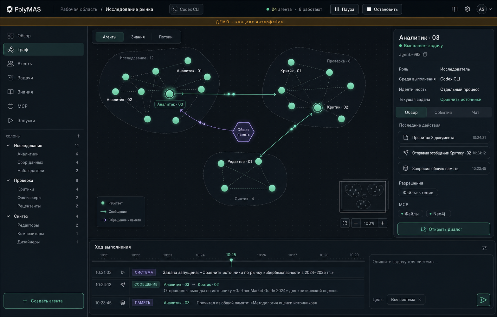
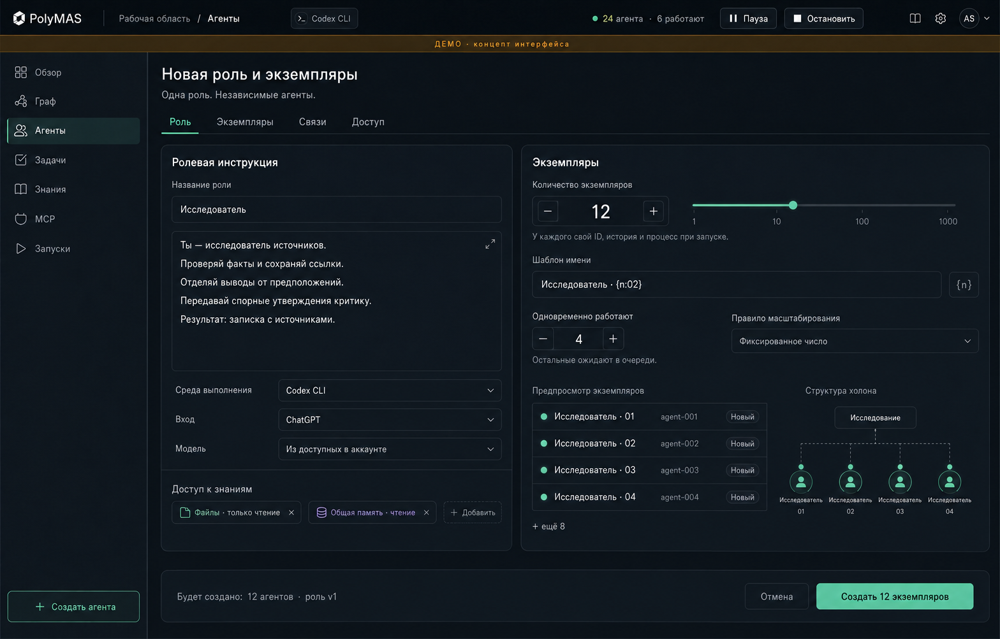
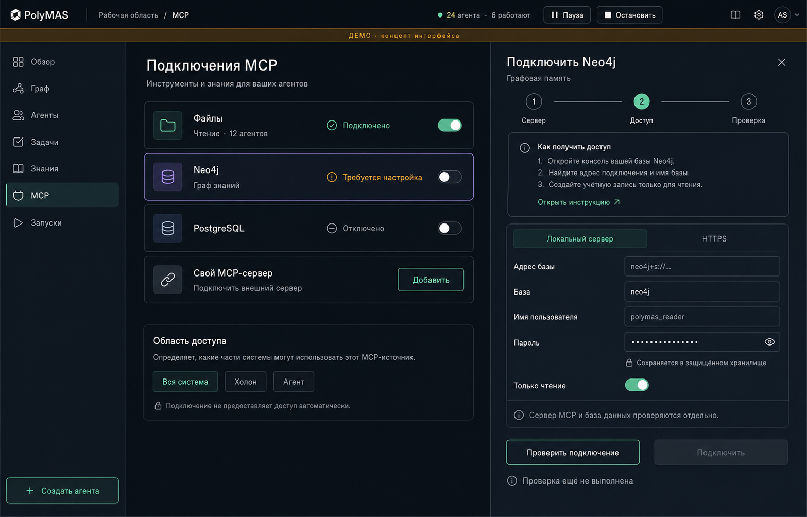

# PolyMAS Studio

Редактор ролей, независимых ИИ-агентов и холонических систем с исполнением через Codex CLI.

**Версия:** 0.1.0, разработка по спецификации. Production-выпуск пока не объявлен: незаконченные функции и обязательные проверки перечислены в [TASKS.md](TASKS.md).

PolyMAS — multi-agent system of multi-agent systems: агент остаётся самостоятельным экземпляром, а группа агентов может быть частью другой группы. Рабочее название продукта — PolyMAS Studio.

В репозитории находятся Rust-служба, Windows-оболочка Tauri, React-редактор, MCP gateway, регрессионные тесты, спецификация и дизайн. Реальные Codex-запуски, чтение файлов через MCP, сообщения двух агентов, ожидание и продолжение прежней сессии проверены; это отдельно от synthetic fixtures и нагрузочных gate. Подробности: [доказательства проверок](specs/evidence/README.md), [история изменений](CHANGELOG.md).

## Запуск из исходников

Целевой desktop — **Windows 11 x64**. Текущая локальная проверка выполнена на Windows 10 22H2; Windows 11 остаётся отдельной ступенью приёмки. Linux используется для проверки domain/daemon и будущих workers, GUI для него не заявлен.

Нужны Git, Node.js 24+, PowerShell 7, Rust MSVC toolchain (проверен 1.97.1), Visual Studio C++ Build Tools с Windows SDK и WebView2 Runtime. Для тестов процессов нужен Python 3.11+. Используйте lockfiles; `scripts/dev-env.ps1` подключает установленный C++ toolchain только к текущему процессу, не меняя настройки ОС.

```powershell
git clone https://github.com/daniil-novel/polymas-studio.git
cd polymas-studio
npm ci
npm run desktop
```

Репозиторий приватный: Git должен быть авторизован для доступа. Команда desktop собирает daemon, подготавливает sidecar, запускает локальную UI-сборку и окно. Порт 1420 должен быть свободен. Credentials службы создаются автоматически и остаются в системном хранилище, вводить control token в настольном окне не требуется.

Для сборки встроенных assets без dev-сервера:

```powershell
./scripts/stage-desktop.ps1
. ./scripts/dev-env.ps1
Push-Location apps/desktop/src-tauri
../../../node_modules/.bin/tauri.cmd build --debug --no-bundle
Pop-Location
```

Результат: `target/debug/polymas-desktop.exe` и соседний `polymas-daemon.exe`; распространять или переносить их нужно совместно. `npm run desktop:build` подготавливает release/NSIS-сборку. Подпись, uninstall drain и полная приёмка installer ещё не завершены, поэтому наличие exe не означает выпуск готового production-дистрибутива.

NSIS-сборка из `9aa7b56` и состав её зависимостей проверены: [среда, хэши, SBOM и оставшиеся условия](specs/evidence/windows-packaging-9aa7b56.md). `scripts/sbom.py` проверяет целостность связей и переносимость CycloneDX 1.5, формирует сводку лицензий; полная проверка схемы и комплект текстов лицензий нужны отдельно.

### Подключить Codex

Адаптер допускает **точную версию 0.144.1**. Установите её штатным способом и выполните `codex login` в своём окружении. Приложение проверяет executable, версию и состояние входа; пароль ChatGPT ему не передаётся. Пока встроенный auth wizard не завершён, вход выполняется через штатный Codex CLI. Инструкции и целевой сценарий: [Codex и MCP](specs/04-integrations.md).

Настройка ChatGPT и API не создаёт дополнительной квоты на каждый экземпляр. Ошибки доступа, sandbox и исчерпания лимита не превращаются в успешную задачу. Текущая desktop-служба запускается с capacity=1; настройка capacity в оболочке находится в очереди работ. Число определений агентов может быть больше, они будут исполняться последовательно в пределах C.

### Первый рабочий сценарий

1. Откройте **Агенты → Создать агента**. Задайте имя роли, инструкцию, контракт результата и число экземпляров. У каждого появится собственный ID и рабочая папка.
2. В **Граф → Архитектура** выберите режим, холоны и разрешённые связи. Координатор и общая память настраиваются независимо. Не превышайте доступную capacity при задании C.

   Нажмите холон слева, чтобы показать его участников и вложенные группы. **Все агенты** возвращает полный граф. **Задача холону** открывает форму с выбранной группой; рассылка всем участникам и вложенным холонам включается явно в форме.
3. При необходимости откройте **MCP → Добавить подключение → Локальные файлы**. Укажите абсолютный путь к специально выделенной папке, проверьте соединение, выберите инструменты и привязку к роли/агенту. Переключатель доступен только после успешной проверки.
4. В **Задачи** задайте адресата, текст, критерии и бюджет. Через инспектор узла можно открыть прямой диалог с агентом.
5. Следите за реальными событиями, результатом и состоянием задачи. Результат требует отдельной приёмки; промежуточный ответ ожидающего агента не принимается как завершённая задача.
6. **Пауза** приостанавливает выдачу новых задач. **Остановить** отменяет незавершённую работу. При закрытии окна можно оставить службу в фоне или остановить её; выбор сбрасывается через tray.

## Что реализовано и что проверять отдельно

В **Агентах → Экземпляры** найдите агента по имени или полному ID, выберите роль и состояние. Архив доступен через фильтр. Таблица показывает закреплённую версию роли, холон, текущее состояние, задачу и исполнителя; широкую таблицу можно прокрутить по горизонтали. Кнопки перехода под таблицей позволяют последовательно просмотреть все строки с клавиатуры. При большой численности в DOM остаётся ограниченное окно строк.

Нажмите имя экземпляра для переименования. Форма сверяет полное ID и текущее имя со службой; изменение сохраняется по показанным данным. При конфликте или потерянном ответе нажмите **Обновить данные**, проверьте текущее имя и свой черновик. Повторная запись автоматически не отправляется. Рабочая папка, сессии и история сохраняются.

В **Задачах → История запусков** доступны поиск по названию/ID, фильтр приёмки и страницы по всей сохранённой истории. Откройте запуск, выберите состояние задач и нужного исполнителя; страницы задач независимы от страниц запусков. Поиск не закрывает выбранный результат, а фоновое обновление сохраняет его и черновик новой задачи. Пока экран скрыт, списки истории не опрашивают службу; после возврата действия ждут свежих данных.

В **Подтверждениях** доступны список операций, сохранённый адрес ресурса, точные параметры и решение по показанной ревизии. Потеря связи отключает действия до обновления; обычный отказ сохраняется в истории. Ожидание владельца освобождает слот и продолжает ту же сессию после решения. Если внешний исход неизвестен, выберите «Нужна сверка», проверьте ресурс и сохраните фактический результат с заметкой. Сверка не вызывает инструмент повторно; до неё приёмка и повтор задачи запрещены. Gateway предоставляет `polymas_request_operation`, `polymas_operation_status` и `polymas_execute_operation`. Запрос действует 15 минут и не совмещается с ожиданием сообщения. Исполнение получает только approvalId, использует сохранённые параметры и не повторяет потреблённую операцию. Неиспользованное разрешение закрытой попытки получает статус «Отозвано». Фоновое обновление сохраняет раскрытые сведения; до свежего ответа и при ошибке обновления решение недоступно.

**Реальная MCP-запись из Codex пока не прошла проверку.** STDIO/HTTP gateway fixtures проходят, а реальный Codex 0.144.1 создал запрос и продолжил ту же сессию после решения в UI, но отменил destructive tool call до обращения к gateway. Контрольный файл не изменился, результат отклонён при приёмке. Для этого пути требуется квалификация интерактивного адаптера; отключение sandbox или безусловное разрешение инструментов не используется.

В **Задачах** выберите запуск и нажмите **Посмотреть запись**. Шкала времени, скорость 0.5×–4× и переходы к сообщениям, чтениям и ошибкам показывают сохранённую архитектуру и события. На паузе можно рассмотреть связь и открыть исходные данные события. Для изменения задач вернитесь к текущему запуску. Просмотр ограничен 100 000 событий; полный body загружается только при выборе. Серверные checkpoints для более длинных записей ещё в работе.

В **Знаниях** зарегистрируйте источник с адресом и версией, выберите его слева и добавьте утверждение. Справа показаны происхождение, срок актуальности и решения проверки; связи задаются между утверждениями. Поиск/фильтры работают по сохранённым данным, большие списки открываются страницами. Если связанное MCP-подключение выбрано общей памятью, агенты с разрешённым чтением соответствующей области могут искать и читать его неистёкшие утверждения. Источники без подключения остаются в реестре владельца. Документ автоматически не импортируется; индексатор и публикация утверждений агентом ещё в работе.

| Область | Текущее состояние |
|---|---|
| Роли и экземпляры | Версии, массовое создание, отдельные IDs/workspaces; расширенные действия экземпляров ещё дополняются |
| Архитектура | Пресеты, вложенные холоны, координатор, независимый флаг памяти, разрешённые каналы |
| Знания | Источники/утверждения/provenance, проверка и связи через настоящий API; визуальный граф знаний и индексатор ещё в работе |
| Исполнение | Codex exec/JSONL, процесс на активную попытку, fencing, отмена, recovery, task-scoped session resume |
| Общение | Peer discovery, send/inbox/ack, bounded wait, пробуждение сообщением или deadline; delegation ещё не завершён |
| MCP | Files, stdio/HTTP discovery/probe, bindings, allowlist, read gateway; write approvals/OAuth/rotation ещё не соединены полностью |
| Граф | WebGL, реальные состояния и доставки, поиск, layout worker, миникарта, доступный список, drag/pinning; агрегация/LOD и расширенная клавиатурная навигация ещё дополняются |
| Сохранение | SQLite/WAL, история ревизий и событий, артефакты с hash, backup/restore в core; часть пользовательских экранов ещё впереди |
| Desktop | Нативный bridge, OS vault, отдельный daemon, reconnect, tray, close preference; native visual gate открыт |
| Масштаб | Fixtures 1000–5000 определений; реальный C=1000, длительная нагрузка и remote workers не подтверждены |

Полное целевое поведение задаёт спецификация; эта таблица описывает реализацию и не сокращает требования.

## Данные и границы доступа

Desktop-профиль: `%LOCALAPPDATA%/studio.polymas.desktop/desktop.sqlite3`. Рабочая область по умолчанию: `workspaces/default` внутри той же папки. Endpoint и ссылка на credential хранятся отдельно от самого секрета. Служба держит exclusive `workspace.lock`; второй процесс не может открыть ту же область.

Полная история задач и артефакты могут содержать ваши данные. Не добавляйте рабочие области, логи, provider sessions или секреты в Git. Копирование только SQLite-файла работающей службы не является полноценным backup: нужны согласованный snapshot и связанные blobs. Проверенный core backup/restore находится в `crates/polymas-core`.

Каждая попытка получает ограниченный MCP grant с отзывом после завершения; он не позволяет управлять редактором. Binding ограничивает инструменты и namespaces. Для внешних БД namespace сам по себе не создаёт row-level isolation: используйте отдельные права/подключения на стороне источника. Текущий профиль рассчитан на доверенного локального владельца, не на изоляцию враждебных арендаторов.

## Проверки и разработка

```powershell
npm ci
./scripts/stage-desktop.ps1
./scripts/check.ps1 -Scope all
```

Проверка включает Rust tests/clippy/format, TypeScript, ESLint, Vitest, production UI build и контрактные примеры. На Linux: `cargo test --workspace`, `cargo clippy --workspace --all-targets -- -D warnings`, `npm test`, `npm run build`; staging GUI не нужен. Windows CI собирает sidecar перед тестами оболочки. Нативные IPC-тесты используют MockRuntime и настоящие capabilities; тесты launcher запускают реальные OS-процессы.

Проверки с внешними ресурсами запускаются отдельно:

```powershell
. ./scripts/dev-env.ps1
cargo test -p polymas-daemon --test native_host native_profile_reconnects_through_the_real_os_vault -- --ignored
python scripts/smoke_service.py --allow-provider
```

Первый сценарий временно создаёт и удаляет fixture в OS vault. Второй использует авторизованный Codex и расходует его доступную квоту. Обычные regression tests не вызывают модель. Реальные результаты, неуспешные попытки, visual QA и ограничения фиксируются в [evidence](specs/evidence/README.md).

Процесс разработки: требование → проверяемый сценарий → наблюдаемый RED → реализация → GREEN → self-review → небольшой коммит → повторная проверка. Один коммит соответствует одному функциональному срезу. Контракт работы: [AGENTS.md](AGENTS.md).

### Навигация по коду

| Путь | Назначение |
|---|---|
| `crates/polymas-core` | Модель, хранилище, планировщик, процессы, MCP-клиенты, policy, знания, артефакты |
| `crates/polymas-daemon` | HTTP API, execution pipeline, scoped gateway и stdio bridge |
| `crates/polymas-desktop-host` | Нативный client, launcher, профили и настройки закрытия |
| `apps/desktop/src-tauri` | Windows window/tray, IPC/capabilities и упаковка |
| `apps/desktop/src` | React UI и WebGL-граф |
| `tests/frontend` | Регрессионные сценарии интерфейса |
| `specs`, `contracts`, `design` | Спецификация, решения, критерии, схемы и визуальные референсы |

### Если что-то не работает

- **Codex не готов:** посмотрите причину в Настройках, проверьте точную версию и штатный вход. Если вход выполнен после запуска службы, остановите её через tray и снова откройте редактор для новой диагностики. Не снимайте sandbox ради зелёного статуса.
- **Конфликт ревизии:** обновите состояние формы и повторно примените осознанные изменения. Старая форма не должна молча затирать новую конфигурацию.
- **Нет связи:** проверьте исход предыдущей команды перед повтором; для задач сохраняется idempotency key. После перезапуска desktop пытается подключиться к прежней службе.
- **MCP не включается:** пройдите probe и настройте binding/allowlist. Для Neo4j нужны действительный endpoint и отдельные credentials.
- **Не хватает слотов:** N — число экземпляров, C — параллельных процессов. Понизьте C до capacity; большее число определений не создаёт ресурсы исполнения.

Не отправляйте credentials и полный private transcript в диагностические отчёты. Для воспроизведения используйте собственные обезличенные fixtures.

**Для чтения одним документом:** [Полная спецификация](SPECIFICATION.md).

[Результаты проверки пакета](specs/07-package-verification.md).

## Читать в таком порядке

| Документ | Что определяет |
|---|---|
| [01 · Продукт и требования](specs/01-product-spec.md) | Термины, роли, экземпляры, холоны, задачи, ядро, масштаб и границы выпусков |
| [02 · Экраны и сценарии](specs/02-ux-spec.md) | Все экраны, поля, действия, состояния, поведение графа и чата |
| [03 · Архитектура исполнения](specs/03-architecture.md) | Codex CLI, процессы, очереди, события, данные, безопасность, восстановление |
| [04 · MCP и подключение Codex](specs/04-integrations.md) | Мастера подключения, секреты, файловое хранилище, Neo4j, произвольные MCP |
| [05 · Разработка по спецификации](specs/05-delivery-and-acceptance.md) | Этапы, проверяемые критерии, матрица трассировки, нагрузка, выпуск |
| [06 · Визуальная система](design/design-spec.md) | Компоновка, размеры, цвета, анимация, состояния и референсы |
| [07 · Решения и источники](specs/06-decisions-and-sources.md) | ADR, проверенные возможности, неопределённости и решения до выпуска |
| [Контракты](contracts/README.md) | Формальные схемы событий, конфигурации и примеры |
| [Промпты дизайна](design/prompts.md) | Системный бриф и точные задания для генерации экранов |
| [Интерактивный макет](design/prototype.html) | Обзор графа, настройка архитектуры, роли, MCP и демонстрационный запуск |

## Ключевые решения

- Один агент — один постоянный ID, собственная история и отдельный процесс Codex во время выполнения. Один процесс не обслуживает несколько экземпляров.
- Число созданных экземпляров N и предел одновременно работающих процессов C задаются отдельно. Если N = C = 1000 и ресурсы/доступ позволяют запуск, это именно 1000 процессов Codex.
- Центральный ИИ-координатор и общая память включаются независимо. В режиме без ядра остаётся техническая инфраструктура приложения: планировщик, доставка сообщений и журнал.
- Нейронный граф показывает реальные наблюдаемые действия. Анимация сообщений основана на событиях доставки; скрытый внутренний ход рассуждений не моделируется.
- Первый production-профиль — локальный Codex через exec и JSONL. App-server выделен в экспериментальный адаптер с отдельным условием допуска.
- Подписка ChatGPT и API-доступ — разные способы авторизации. Число экземпляров не умножает лимиты аккаунта.
- Тысячи экземпляров поддерживаются моделью продукта с первого дня; доказанная одновременная работа тысяч процессов — отдельная обязательная ступень масштабирования.

## Дизайн-референсы







Изображения задают композицию и стиль. Точные состояния, счётчики и поведение определяются текстовой спецификацией и контрактами, а не случайными деталями генерации.

## Выпуск

Выпуск требует закрытия обязательных сценариев [плана приёмки](specs/05-delivery-and-acceptance.md), финального self-review, измерений и подписанного installer. Реальные Neo4j, C=1000/8-часовой soak, Windows 11 и native screenshot/close остаются явно отделёнными от unit/fixture проверок. Репозиторий частный; правовой статус указан в [LICENSE](LICENSE).

Браузерная регрессия раскладки: `npx playwright install chromium`, затем `npm run test:e2e`. Она поднимает отдельный UI на порту 1432 и использует только авторские API-fixtures; рабочая служба, секреты и модель в этой проверке не используются. CI выполняет её отдельным заданием и сохраняет trace при ошибке.

Результат одобренной операции доступен владельцу через `/api/approvals/{id}/result` страницами до 32 КиБ. Агент читает большие ответы через `polymas_read_operation_result` только в точном продолжении и при действующем доступе. `execute/status` передают `resultMetadata` (размер и SHA-256), а inline `result` — только для небольшого ответа. Повторное чтение не вызывает MCP. В карточке операции нажмите «Показать ответ» для просмотра по частям или «Скачать ответ JSON» для полного файла. Перед скачиванием проверяется SHA-256; загрузку можно отменить. Браузерный экспорт проверен; сохранение через нативное окно Windows остаётся отдельным gate.
